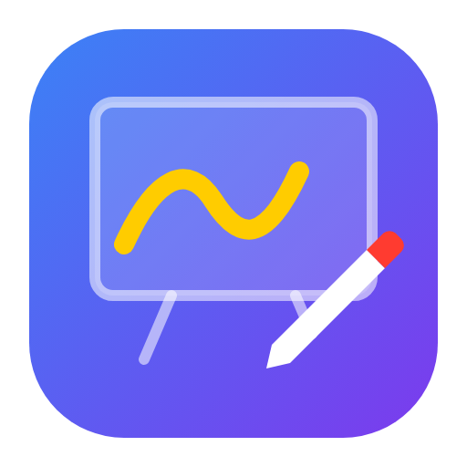

<p align="center"></p>

# Inkora

**Draw on anything. Teach anything.**

Inkora is a professional screen-annotation and presenting app for online teachers. It puts a
transparent ink layer over any app (Zoom, Teams, Google Meet, OBS, PowerPoint, PDFs, the
browser) so you can draw, highlight, point, record and explain, then save the lesson for
next time. Runs on Windows, macOS and Linux, and is optimized for pen tablets such as
**Huion**, Wacom, XP-Pen and Surface.

A floating toolbar switches between **mouse mode** (clicks go through to your apps, your
drawings stay visible) and **draw mode** (Inkora captures the mouse or pen).

## Features

### Ink
- **Pen** with smooth strokes and **pressure sensitivity**: adjustable pressure response,
  minimum width and stroke smoothing (stabilizer)
- **Highlighter**, **eraser** (whole shapes, also the eraser end of a stylus)
- **Smart shapes**: draw a rough line, box, circle or triangle and it becomes a clean shape
- **Line, arrow, double arrow, rectangle, ellipse, triangle, diamond, speech bubble**:
  hold **Shift** for 45° lines, squares and circles; **fill** and **dashed** options
- **Text** and **sticky notes** (double-click to edit later)
- **Stamps** ✓ ✗ ★ ♥ ? ☺ and **numbered step badges** (1, 2, 3…)
- **Fading ink**: strokes disappear after a few seconds
- **Paste** images or text, **insert images** from files

### Editing
- **Select tool**: click or box-select, drag to move, **resize from the corner handle**,
  arrow keys to nudge, recolor, **copy / cut / paste** (`Ctrl+C/X/V`), duplicate (`Ctrl+D`),
  bring to front / send to back (`Ctrl+]` / `Ctrl+[`)
- **Undo / redo** (200 steps)
- **Quick palette** on right-click or the pen's side button

### Presenting
- **Laser pointer** with a fading trail
- **Spotlight** (dims everything but a circle around the cursor) and **magnifier**
- **Screen curtain**: hide part of the screen and reveal it step by step
- **Freeze screen**: pause a video or animation and draw on it
- **Cursor highlight** that follows the mouse, even in mouse mode
- **Whiteboard / blackboard / chalkboard** with **plain, grid, lined, dot or coordinate-axes**
  patterns, and **multiple pages**
- **Open PDFs and images as board pages** and annotate them like slides
- **Webcam bubble** (circle or rounded, resizable, mirrored) floating over your content
- **Class timer**: countdown with presets and alarm, or stopwatch
- **Multi-monitor**: draw on every display

### Record, save & share
- **Screen recording** with your **microphone** (and **computer sound** on Windows), 3-2-1
  countdown, pause/resume, toolbar hidden from the video; saved as MP4 (WebM where MP4
  isn't available)
- **Screenshot** to file or clipboard, **export annotations as PNG**
- **Export board pages as PDF** handouts
- **Lessons** (`.inkora` files): save all drawings and board pages; double-click to reopen
- **Autosave** every 30 seconds with **Restore Last Autosave**

### App
- **Settings window**: customizable global shortcuts with conflict detection, your own color
  palette, vertical or horizontal toolbar, toolbar size and opacity, dark or light theme,
  pen-tablet tuning with a **test pad**, recording and webcam devices, start at sign-in
- Tray icon with the full menu; remembers your last tool and options

## Install and test on your PC

### Option 1: download a ready build (recommended)
Every push builds installers with GitHub Actions:

1. Open the repository on GitHub → **Actions** → **Build Inkora** → the latest run.
2. Under **Artifacts**, download **Inkora-Windows** (or macOS / Linux) and unzip it.
3. Windows: run `Inkora-2.0.0-win-x64.exe` (installer) or `Inkora-2.0.0-portable.exe`
   (no install needed). The builds aren't code-signed yet, so Windows SmartScreen may say
   "Windows protected your PC": click **More info → Run anyway**.
4. macOS: open the `.dmg`, drag Inkora to Applications, then the first time **right-click →
   Open** (unsigned app). Allow *Screen Recording*, *Microphone* and *Camera* when asked.

### Option 2: run from source
Requires [Node.js](https://nodejs.org/) 18 or later.

```bash
cd inkora
npm install
npm start
```

Build installers yourself (output in `dist/`):

```bash
npm run dist
```

Run the unit tests: `npm test`.

## Using a Huion (or other) pen tablet

1. Install the latest driver from huion.com.
2. In **HuionTablet → Pen settings**, turn on **Windows Ink** (needed for pressure in Windows
   apps). If strokes still have no pressure, restart Inkora after changing the setting.
3. Map the tablet to the screen you teach on (driver → *Work area → Screen*).
4. In Inkora → **Settings → Pen tablet**:
   - *Pressure response*: lower = softer (light touch gives thick lines), higher = firmer.
   - *Thinnest line*: how thin the line gets at the lightest pressure.
   - *Stroke smoothing*: 0 = raw, 3 = default, higher = steadier handwriting.
   - *Pen side button*: quick palette (default) or eraser.
   - *Ignore touch input*: palm rejection for touch screens.
   - Use the **test pad** to check pressure; it shows the raw and adjusted pressure values.
5. The eraser end of the pen erases automatically.

Inkora draws pen strokes incrementally, uses every coalesced pen sample and shows a short
predicted segment ahead of the pen tip, so fast handwriting stays smooth and attached to
the nib.

## Shortcuts

### Global (work from any app; change them in Settings)

| Shortcut     | Action                        | Shortcut     | Action                 |
| ------------ | ----------------------------- | ------------ | ---------------------- |
| `Ctrl+Alt+D` | Toggle draw / mouse mode      | `Ctrl+Alt+F` | Freeze screen          |
| `Ctrl+Alt+Z` | Undo                          | `Ctrl+Alt+G` | Spotlight              |
| `Ctrl+Alt+C` | Clear                         | `Ctrl+Alt+M` | Magnifier              |
| `Ctrl+Alt+H` | Hide / show annotations       | `Ctrl+Alt+L` | Cursor highlight       |
| `Ctrl+Alt+T` | Hide / show toolbar           | `Ctrl+Alt+R` | Start / stop recording |
| `Ctrl+Alt+W` | Whiteboard on / off           | `Ctrl+Alt+K` | Webcam bubble          |
| `Ctrl+Alt+S` | Save screenshot               | `Ctrl+Alt+I` | Class timer            |
| `Ctrl+Alt+Q` | Quit                          |              |                        |

On macOS `Ctrl` is `Cmd`.

### In draw mode

| Key                             | Action                                                     |
| ------------------------------- | ---------------------------------------------------------- |
| `V` `P` `H` `E`                 | Select, pen, highlighter, eraser                           |
| `K` `G` `Z` `U`                 | Laser, spotlight, magnifier, curtain                       |
| `T` `Y`                         | Text, sticky note                                          |
| `L` `A` `X` `R` `O`             | Line, arrow, double arrow, rectangle, ellipse              |
| `N` `M`                         | Number badge, stamp                                        |
| `S` `F` `D` `I` `C`             | Toggle smart shapes, fill, dashed, fading ink, cursor highlight |
| `1`–`8`                         | Palette colors                                             |
| `[` / `]` or mouse wheel        | Smaller / bigger                                           |
| `B`                             | Cycle screen → whiteboard → blackboard → chalkboard        |
| `Page Up` / `Page Down`         | Previous / next (or new) board page                        |
| `Ctrl+Z` / `Ctrl+Y`             | Undo / redo                                                |
| `Ctrl+C` `Ctrl+X` `Ctrl+V`      | Copy, cut, paste                                           |
| `Ctrl+D` / `Ctrl+A`             | Duplicate / select all                                     |
| `Ctrl+]` / `Ctrl+[`             | Bring to front / send to back                              |
| `Enter`                         | Edit the selected text or note                             |
| `Delete`                        | Delete selection (or clear everything)                     |
| `Esc`                           | Close palette / deselect, then back to mouse mode          |
| Right-click / pen button        | Quick palette                                              |

The **⋯** button (and the tray icon) has everything else: boards, patterns, pages, PDF
import/export, stamps, recording, lessons, autosave restore and settings.

## Tips for online teaching

- **Zoom / Teams / Meet:** share your *entire screen* (not a single window) so students see
  the ink, the webcam bubble and the timer.
- **OBS:** use a *Display Capture* source, or record directly with Inkora.
- Open your worksheet PDF as board pages, annotate it live, then **Export Board Pages as
  PDF** and send the annotated handout to your students.

## Platform notes

- **macOS:** allow *Screen Recording*, *Microphone* and *Camera* in System Settings →
  Privacy & Security.
- **Linux:** transparency needs a compositing window manager (GNOME, KDE and most modern
  desktops have one).
- Computer sound in recordings is supported on Windows; microphone recording works
  everywhere.

## How it works

```
main.js            Main process: windows (overlay per display, toolbar, settings, webcam,
                   timer), state, shortcuts, tray & menus, capture, recording, PDF import/
                   export, lessons, autosave
preload.js         The only bridge between pages and the main process (contextIsolation)
lib/settings.js    Settings defaults, validation and persistence (unit tested)
src/overlay.*      Transparent drawing surface: tools, tablet input, selection, history,
                   pages, presenting effects
src/render.js      Canvas drawing of shapes, stamps, notes and board patterns
src/geometry.js    Hit-testing, bounds, scaling, smart-shape recognition, file validation
                   (unit tested)
src/toolbar.*      Floating toolbar        src/settings.*  Settings window
src/camera.*       Webcam bubble           src/timer.*     Class timer
src/recorder.*     Hidden screen recorder  src/pdf.*       Hidden PDF page renderer (pdf.js)
build/             App icon used by the installers
```

Every page runs sandboxed with context isolation. PDFs are rendered with scripting and eval
disabled, and lesson files and pasted shapes are validated shape by shape before loading.
